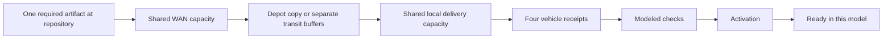

# FleetLab next design specification: one update, four vehicles

October 12, 2026 · Audit-amended Revision 4 · **First-slice numerical contract frozen; package-only release authorized; NF-04 engine and experience remain unimplemented.**

## Decision and continuity

Keep the NF-03 entry **“Explore depot operations”** and catalog lead **“Start with depot operations.”** Preserve the observed whole-run/individual trade-off, Home / Explore / About & limits, existing warm ivory/forest/teal identity, all 61 lessons, optional film and complete offline edition. City Explorer remains a visible secondary path with its qualification limits. No broad redesign is part of this task.

The next lesson is **NF-04: “One update. Four vehicles. Where is the wait?”** Its first useful slice compares repeated download with a cold shared cache. One accepted pair must drive the two-arm bench, shared clock, selected vehicle, causal inspector, phone arm switch, static chapters and six-beat guide. Preload is specified now as a later UI question with its earlier work visible.

The [October 12 contract](FLEETLAB_NF04_A_CONTRACT_AND_PACKAGING_PROPOSAL_2026-10-12.md) freezes M1/M3 and the cold/repeated numerical semantics, settles M2's common preload windows, and selects M4's B-lite packaging proof. The [decision log](FLEETLAB_REV3_AUDIT_DECISIONS_2026-10-12.md) records authority and scope. The owner's current authorization covers packaging build, validation, Git push and educational-site publication; NF04-B still needs a separate implementation decision after the proof. No NF-04 engine, verifier, accepted execution record or deployed lesson is claimed.

| Source/evidence | Meaning |
| --- | --- |
| Current NF-03 app `87733ad0b7dd73f65b1742aff4c9253c99e6f391` | Revision 3 [immutable NF-03](https://1b5e00d3.fleetlab.pages.dev/network-flows/capacity/), reported by its October 10 handoff. |
| Starting checkout `9d47e4cbc8be63897d4d459a8b8a507c5ae3e29a` | Documentation/receipt changes since `87733ad`; source for fresh packaging work must be identified in its final receipt. |
| Historical app `1141b12160018216c3baf6875278fe0890762b15` | Revision 2 [immutable NF-03](https://27abffcd.fleetlab.pages.dev/network-flows/capacity/); old inventory/headroom remain historical. |
| October 10 audit | Observed NF-03 at 1363×936; analytical NF-04 checks and recommended amendments. Not engine execution, cap approval or publication authority. |
| This revision | Frozen design and delivery decisions; fresh proof/release results belong in a completed handoff. |

SF remains **HOLD / BLOCKED_MAP_QUALIFICATION**; Austin and held power-study work remain paused. Q1/Q8/N2 are preserved below. The historical [October 10 specification](FLEETLAB_NETWORK_FLOWS_NEXT_DESIGN_SPEC_2026-10-10.md) is unchanged.

**Product promise:** visitors can see what work is required, which resource or prerequisite is holding a vehicle, what changes between two choices, and what the result does not establish.

**Why this belongs in Network Flows:** a fleet's available service depends on a network of work and constrained resources. Software delivery gives a concrete example of shared-object reuse, upstream versus local capacity, prerequisite ordering and readiness deadlines. It is a bounded resource-flow lesson, not a min-cost-flow optimizer or a reconstruction of any operator's infrastructure.

## What a visitor should learn

| Visitor question | Mechanism to expose | Useful professional takeaway |
|---|---|---|
| Why download the same object four times? | Unique artifact identity versus independent transfer identity | Engineering: identify reusable work before changing a scheduler |
| Why is a downloaded vehicle still waiting? | Receipt → modeled checks → activation → ready | Product: define the actual completion criterion |
| Does a cache solve every delay? | Separate WAN and local shared capacities | Operations: identify the remaining bottleneck |
| Is a preloaded cache free? | Work before arrival and a separate accounting window | Fleet management: evaluate availability and resource use together |
| What should a depot partner provision? | Arrival/work distributions, useful link rates, local capacity and deadlines | Partnerships: request measurements before sizing a real facility |
| Did every vehicle benefit? | Per-vehicle status and full denominators | Reviewers: inspect exceptions and unfinished work, not only an average |

No real demand, fares, revenue, trip counts, injury rates, remote guidance rates or driving-safety outcomes are inferred. Monetary estimates require viewer-supplied unit prices and an explicit cost model in a later phase.

## Experience and visual language

The hosted route is provisionally `/network-flows/software-delivery/`. Explore will contain one card, labelled as an interactive synthetic model only after its implementation passes acceptance. Until then, avoid a dead “Run” button or a badge implying accepted results.

Use the existing ivory background, forest text and teal accent. Body copy is about 18 px; readable labels are at least 14 px. Controls target 44 px. Keep one question, one short scope line and one primary action above the first phone fold. Assumptions and exact records remain one disclosure away.

The desktop bench uses two aligned panels with a single time axis. Each panel has a repository, WAN connection, clearly named depot storage, local connection and four parked vehicle symbols. Distinguish **reusable cache** from **non-reusable transit buffers** in words. Cars do not travel along invented routes.

Dependency lines show logical order. Rate bars encode quantities on the same physical scale in both panels. Directional dots may move only while an accepted record shows positive transfer; their speed is illustrative, never a packet trace or throughput scale. Energy and driving are out of this lesson's mechanism.

On phones, show one selected arm with an explicitly named **Repeated download / Cold shared cache** switch. At 320 px, stack the two whole-run outcome summaries when necessary; do not shrink them into unreadable side-by-side cards. Keep both final outcome summaries, the shared clock and the selected vehicle visible near the switch. Changing the visible arm, screen size or vehicle never runs a model or resets the clock. A text inspector titled **“Why this state?”** changes its explanation for receiving, checking, activating, ready, failed and unfinished requests. It names the relevant prerequisite, remaining useful bytes or task time, and current accepted allocation. Rejected evidence uses a separate error state, never a simulated vehicle fault.

**Watch comparison** expresses one playback intent: reconstruct both records, independently check them, then start the accepted guide when its bench is visible. Keep progress, Cancel and a way to pause pending playback. A rejected record, cancelled job, input edit, newer Watch or route exit invalidates that intent; a late response cannot revive it. Merely opening the lesson starts no simulation or animation. Distinguish published summary from the currently accepted loaded pair.

Provide Pause/Resume, Replay, direct chapters and **Inspect full timeline** with previous/next event, speed and keyboard-operable scrubbing. A 35–45-second editorial guide may skip to accepted event snapshots and hold them for explanation; label those jumps and retain the exact simulated clock. Whole-run outcomes remain fixed while cursor quantities change. Do not imply that guided wall-clock pacing is proportional to model time.

Manual Pause persists across visibility, resize and history restoration. An automatically hidden/offscreen pause may resume only the same accepted intent at the displayed playhead, without catching up elapsed wall time. Ended playback stays ended. Reduced motion or applicable data-saving preferences cancel automatic presentation; changing the preference back cannot silently restart it. Reduced motion presents chapter steps and exact tables with the same conclusions. Announce user-requested chapter changes and errors, not every frame. On a phone, arm switching must preserve time and vehicle.

## The first comparison and its storyboard

Default comparison: **four repeated downloads versus one cold shared cache**. Both begin with no useful depot copy, serve the same four requests and require the same artifact. Preloaded inventory is deliberately not the default control.

The figures below are **analytical fixture expectations**, not published simulation measurements.

| Shared simulated time | Cold cache | Repeated download | Narration |
|---:|---|---|---|
| 0 s | One WAN transfer begins | Four independent WAN transfers begin | Same required object and four consumers; different upstream work |
| 96 s | 12 GB cached; local delivery begins | 12 of 48 GB transferred in aggregate | Reuse removes repeated WAN work |
| 288 s | All four receive the object; checks begin | WAN transfer continues | Receipt is not readiness |
| 348 s | Checks pass; activation begins | WAN transfer continues | Required tasks remain separate |
| 378 s | Four ready in this model | 47.25 of 48 GB WAN transferred | The consequence is readiness timing |
| 384 s | Already ready | WAN complete; local delivery starts | Local work was not eliminated |
| 480 s | 4/4 ready by the target | 0/4 ready; 24/48 GB locally delivered | Evaluate both arms at the same deadline |
| 576 s | Already ready | Receipt complete; checks begin | Local delivery totals match |
| 636 s | Already ready | Checks pass; activation begins | Readiness still waits on activation |
| 666 s | Already ready | Four ready in this model | Inspect the entire completion path |

Offer a six-stop guided explanation: 0, 96, 288, 378, 480 and 666 seconds. All ten boundaries remain in the event table and previous/next-event navigation. Guided explanatory holds are not proportional durations. Continuous playback at 30× takes 22.2 seconds to reach 666 seconds; display that speed and the simulated clock.

After verified implementation, a supported conclusion would be: “In this fixture, shared caching uses 36 GB less WAN traffic and completes all four readiness chains 4 minutes 48 seconds earlier. Local delivery stays at 48 GB in both arms.” Do not generalize this to real fleet savings.

## Frozen first-slice numerical protocol

| Input | Frozen design value |
|---|---|
| Requests | V1–V4, arrival at 0, identical required artifact identity, version and digest |
| Object size | 12,000,000,000 bytes; decimal GB |
| WAN useful capacity | 1 Gbit/s = 125,000,000 bytes/s aggregate |
| Local useful capacity | 2 Gbit/s = 250,000,000 bytes/s aggregate; same per-vehicle maximum |
| Allocation | Capped equal share with residual-only cursor advancement over an immutable canonical transfer-ID universe; exact algorithm and fixtures in NF04-A A1 |
| Transfer dependency | Complete-file store-and-forward; no local transfer before the relevant full receipt |
| Transit storage | Declare N×S bytes of non-reusable provision: 48 GB for default N=4, S=12 GB; 256 GB for four requests for a 64 GB object. Storage contention excluded. |
| Shared cache | Declare S bytes of valid-object provision: 12 GB default, 64 GB at the size maximum; obsolete inventory retired before replacement. No eviction optimization. |
| Vehicle prerequisites | Independent modeled checks of 60 s, then independent activation of 30 s; energy already satisfied |
| Target | Ready at or before 480 s counts as on time |
| Horizon | 2,400 s |
| Preload follow-on | Same P=available_at=−96 s in both arms; cold control idles before arrival, preload may fetch. Inventory at zero is derived from accepted earlier events. |
| Accounting windows | First slice: both P=0 and main [0,2,400 s). Later preload pair: both main [0,2,400 s), earlier [−96,0), full [−96,2,400 s). Ending-boundary completions processed. |

The [October 12 NF04-A companion](FLEETLAB_NF04_A_CONTRACT_AND_PACKAGING_PROPOSAL_2026-10-12.md) freezes the exact numerical and projection rules for the cold/repeated slice. It incorporates audit M1–M3 and supersedes the historical provisional fractional-carry/cursor and state-attribution wording. The separately authorized package-only proof must pass before a further decision to start NF04-B.

Primary quantum is 1,000 ms; refinement is 250 ms. Configured aggregate and per-transfer useful rates must be integer bytes/second divisible by four, representable at both quanta. There is no fractional carry in v1. A 1 B/s cap is rejected even if a run selects 1 s; it is never silently floored to zero at 250 ms. Unused whole-byte capacity is discarded each slot. Capped grants redistribute within the allocation decision, while eligibility stays fixed for that slot and downstream work cannot start early. The exact simultaneous water-filling rounds and residual-only advancement in A1 are normative for this frozen design.

At each boundary, apply preceding completions, apply arrivals/availability/inventory, then process a bounded zero-duration prerequisite closure before readiness/deadline evaluation. Start positive tasks and grant next-slot service only below the aligned horizon. At H, a check ending with zero-duration activation may become ready at H; positive activation remains unfinished and does not start. Cycles are rejected before execution; at most 32 task nodes can terminate in a boundary closure. Off-boundary arrivals become eligible at the next boundary; positive task durations round upward, while raw deadlines remain unrounded and inclusive.

Quantitative snapshots show cumulative work **through t**, with useful rates from grants for **[t,t+Δ)**. Snap inspection to accepted boundaries and display the snapped time. At cold-cache 96 s WAN is complete with zero WAN rate and local delivery becomes active; at 288 s local delivery has zero next rate and checks begin. At H all service rates are zero. Whole-run summaries remain fixed while cursor state changes.

The selected request and the shared resources are separate projections. During checking, activation, failure, readiness or pre-arrival, no transfer is attributed to that request unless its own accepted transfer is active; shared WAN/local bars still sum every accepted grant. A selected vehicle waiting for a reusable depot copy is not itself receiving the shared fetch. Explain zero grants from prerequisites, remaining work, individual caps, aggregate capacity and allocation. Name a zero individual cap as **“This transfer is capped at 0 B/s.”** Name zero aggregate capacity separately. Show all relevant values if several constraints bind; competing IDs alone do not prove contention.

Repeated downloads have per-request WAN dependencies, not a global barrier across vehicles. A staggered arrival must not prevent an earlier complete receipt from starting its own local delivery. At time zero a finished prefetch updates inventory once; its bytes remain solely in the earlier-window transfer ledger. Unknown pre-existing cache stock is declared inventory with unavailable transfer history, never invented measured WAN traffic.

Evaluate a modeled check failure at the end of its complete declared check duration. A failed request never activates. If any required request fails, all-ready time is null, while the other vehicles' outcomes and complete accounting remain available. Record rejection is a different condition and withholds accepted playback.

Both arms must receive identical exogenous inputs. Primary comparisons use one quantum per pair. Report refinement differences for off-boundary arrivals and non-divisible sizes, including maximum completion-time difference and changed outcomes. Equality in the convenient base fixture is not a convergence proof.

### Specified preload follow-on

Both arms validate common P=available_at=−96,000 ms and identical exogenous inputs. Only the preload policy can fetch before first arrival; the cold control records idle earlier slots. Do not give the control P=0 while its availability is −96 s. When earlier events are present, inventory at zero follows those events and cannot assume an unfinished fetch has completed.

| Analytical quantity | Cold control | Preload intervention |
| --- | ---: | ---: |
| Earlier WAN `[−96,0)` | 0 GB | 12 GB |
| Main WAN `[0,2,400)` | 12 GB | 0 GB |
| Full WAN `[−96,2,400)` | 12 GB | 12 GB |
| Earlier local delivery | 0 GB | 0 GB |
| Main / full local delivery | 48 / 48 GB | 48 / 48 GB |
| Readiness after arrival | 378 s | 282 s |
| Elapsed to readiness from common P=−96 s | 474 s | 378 s |

The preload intervention's 378 s from fetch start is correct; it is not the control's elapsed time from P. Unknown pre-existing stock uses **NOT_AVAILABLE** transfer history, never a measured full-history WAN=0. These are contract calculations; preload UI is deferred and no executed preload record is claimed.

## Records, verifiers and meaningful failures

Keep the existing boundary: contract → bounded engine → immutable record → independent verifier → accepted presentation projection → UI. The renderer consumes a shared accepted projection; it never recomputes verification, readiness or a winner score.

Frozen numerical limits are 1–4 requests, one required object, at most 8 transfers per arm, 32 task nodes, 12,000 slots across the full window, 130,000 record entries and 32 MiB per record. Rates, byte/time arithmetic, parsing limits and source availability are fully specified in NF04-A. These are resource bounds, not measured device performance. The first slice uses P=0; negative recording windows and preload controls are a later UI extension. Storage provisions are assumptions, not measured occupancy, equal footprints, disk performance or cost; no new storage engine is needed.

A versioned record needs scenario/model/policy/verifier identifiers; artifact and transfer IDs; request/vehicle IDs; initial inventory; time quantum and event ordering; grants and actual transferred bytes; task start/end/outcome; accounting windows; per-resource capacity and unused work; completion and horizon states; per-vehicle deadlines; and record/input digests. Bounds on requests, events, time horizon and bytes are part of input validation.

Maintain separate ledgers for:

1. **Unique required artifact bytes:** 12 GB in the default four-vehicle fixture.
2. **WAN transferred bytes:** repeated/cold/preloaded full-accounting totals 48/12/12 GB.
3. **Vehicle-local delivered bytes:** 48 GB in every default arm.
4. **Earlier inventory and work:** including obsolete objects and preload transfer, with no double counting.

Do not sum the two network ledgers and label the result “unique data.” Main-window zero WAN in a preloaded case must sit beside 12 GB before arrival and 12 GB for the full window.

| Condition | Correct behavior |
|---|---|
| Wrong cached version | Cache miss; retire obsolete object before replacement in this one-object model; preserve prior inventory accounting |
| V4 fails modeled checks | Valid failed outcome: show the other three vehicles; cold-cache on-time becomes 3/4; all-four readiness is not achieved |
| Pending at horizon | Keep the vehicle in denominators; null completion time; distinguish unfinished work from a completed late task |
| Independent verifier rejects record | Withhold accepted playback and derived success claims; retain previous accepted result clearly labelled if one exists |
| User edits while loading | Cancel stale job; mark old results “Previous setup”; replace atomically only after all new records are accepted |
| User cancels | Retain accepted data and time; do not display partially verified cells |

Modeled checks do not implement cryptographic signatures, anti-rollback, Uptane, actual software flashing or release authorization. Internally consistent records are not authenticated operator evidence.

## Acceptance matrix

| Fixture | Analytical all-ready expectation |
|---|---:|
| Four vehicles, repeated | 666 s |
| Four vehicles, cold cache | 378 s |
| Four vehicles, preloaded | 282 s after arrival; 378 s from prefetch start |
| One vehicle, repeated and cold | Both 234 s; no claimed reuse benefit |
| Four, cold, local link 0.25 Gbit/s | 1,722 s |
| Four, repeated, local link 0.25 Gbit/s | 2,010 s |

Require independent conservation checks, aggregate/per-transfer capacity checks, no service before arrival, no local receipt before WAN prerequisites, no readiness before successful tasks, unique completion, deadline ordering, exact horizon censoring, deterministic tie handling and repeated-record identity. Mutate grants, byte totals, inventory, task order, version/digest identities and timestamps to prove rejection. Do not share engine allocation helpers with the verifier.

Before accepting the applicable first-slice cases above, exercise the discriminating fixtures below. Preload cases remain acceptance for its later extension:

| Contract edge | Required expectation |
|---|---|
| Remaining work 1/99, budget 10, neither capped | Grants 1/9; no wasted whole bytes while eligible work can use them |
| Same work, second flow capped at 4 | Grants 1/4; 5 unused, not carried as future burst capacity |
| Long idle period before first arrival | Only current-slot integer capacity; no carry, accumulated burst or cursor reset |
| Two continuously eligible flows, one byte per slot for ten slots | A/B alternating, 5/5, final cursor A; identical under input permutation; realize with 4 B/s at 250 ms |
| Nonrepresentable aggregate or per-transfer cap | 1 B/s and 6 B/s rejected at either selected quantum; 4 B/s supported |
| Completion at 2,000 ms | Misses raw 1,999-ms target; meets inclusive 2,000-ms target |
| Completion exactly at horizon | Preceding completion and zero-duration closure evaluated; zero activation may finish; positive activation cannot start |
| Prefetch completes at zero | Inventory changes once; no duplicated transfer bytes in main window |
| Fair 5/5 grant changed to 9/1 with unchanged total | Independent allocation-policy verification rejects it despite conservation |
| Staggered arrivals | Two repeated 12 GB requests at 0 and 100 s: V1 own rates 0 while checking; shared WAN=1 Gbit/s at 150 s from V2, shared local=2 Gbit/s at 200 s from V2. No global WAN barrier. |
| Zero individual cap | Lone arrived transfer, available source, positive aggregate capacity, cap=0: no service; name the 0 B/s cap, never invented competition. Also exercise zero aggregate and both-zero cases. |
| Maximum object size | Four 64 GB requests declare 256 GB repeated and 64 GB cache provision; no fabricated disk bottleneck. |
| 4-byte horizon fixture | WAN/local=4 B/s, Δ=1 s, H=2 s, zero tasks: ready at H; target 2,000 ms met, 1,999 ms missed. Positive activation remains unstarted/unfinished. |
| Discretization counterexample | One byte, WAN/local=4 B/s, zero tasks, raw deadline 1 s: readiness 2 s at Δ=1 s versus 0.5 s at Δ=250 ms; deadline outcome changes. |
| V4 fails its full check | Three may become ready; V4 never activates; all-ready remains null |

The 666-second default story endpoint is not the 2,400-second simulation horizon. If all requests are ready or failed, use the latest terminal event across both arms as the finite guide endpoint; if any request is unfinished, use H. A cold-only failure example ends at 378 s with three ready, V4 failed at 348 s and null all-ready. Never loop waiting for an impossible all-ready event.

UI acceptance covers invalid-record refusal, valid modeled-failure playback, pending/previous-state labels, stale completion, pure playback/seek/select/resize, common-scale rate marks, keyboard and touch targets, reduced/hidden motion and all four vehicles' outcomes. Measure cold load and compare latency on the actual tested device. Keep automated phone viewport evidence separate from physical Pixel, Safari, screen-reader and novice comprehension reviews.

## Delivery, assets and cost of fidelity

Use the current small HTML/SVG approach. NF-04 stays hosted-only; preserve NF-01/NF-02, all existing lessons and the complete offline edition. Existing legacy hosted text remains capped at **2,621,440 B**, and offline at **2,621,440 B with 50,000 B reserve**.

The current Revision 3 application baseline is `87733ad`, with starting documentation checkout `9d47e4c`. The October 10 handoff reports **2,621,323 B** hosted text (**117 B** legacy margin), **2,549,837 B** offline (**21,603 B** after reserve), and **1,619,535,612 B** integrated site. These are source-dated reported measurements. Historical `1141b12` had 1,232 B hosted margin; do not reuse it as current headroom. Current raw-source/tools, closure, source-offer and whole-site counts must come from the fresh package proof.

**Select B-lite:** preserve the deduplicated teaching build and one atomic integration, adding a reproducible source offer and complete counters. The immutable Cloudflare deployment hostname supplies reviewer reproducibility; the integration manifest binds its exact files and relative shared paths. This replaces independent route-digest paths and pointer/deployment machinery. No separate route pipeline or mutable `/shared/latest` namespace is introduced.

The stable production alias can span a deployment switch or cached prior files during an open browser session. This proof adds no runtime generation pinning. Full byte/header readback establishes consistency at measurement time, not browser-session atomicity. This is the accepted B-lite tradeoff; reproducible review uses the immutable deployment URL.

The [companion A6](FLEETLAB_NF04_A_CONTRACT_AND_PACKAGING_PROPOSAL_2026-10-12.md) specifies separate **3 MiB raw-source/tool and aggregate emitted-text gates**, **512 KiB NF-03 complete closure**, **4 MiB compressed and extracted source-offer limits**, **7 MiB text plus stored source offer**, and **14,360,576 B current teaching generation**. Prospective NF-04 targets are **350 KiB route-local / 512 KiB complete closure**; shared dependencies count fully in each closure and once per physical aggregate path. These do not enlarge the legacy gate. A future Explore-card fixture must report its exact source/emitted cost and owner, and any legacy deficit; never relabel those bytes under the future route allowance.

Current source and tiny fixtures must prove closure/ownership, reproduction, source/commit binding, mismatch rejection, offline preservation and rollback before NF04-B. The owner has authorized this packaging build, validation, push and publication; actual pass/fail and deployed identities belong in its completed handoff. This design does not predeclare the proof passed.

Blender is optional for an original still or a short setting shot. It does not become the simulation engine, and photorealism is not evidence of model adequacy. Prefer a small compressed poster with descriptive alternative text and a precise vector overlay. No generated text, topology, rate values or operator logos in the quantitative diagram. A video cannot replace keyboard controls or the inspectable record. Measure the asset's contribution separately and keep it out of the offline graph.

No new runtime backend, telemetry, paid API or 3D dependency is required for this lesson. MetaDrive or MuJoCo is warranted only when a later research question requires driving interactions or physical contact/actuation respectively; neither is needed to answer this resource-flow question.

## Delivery sequence and exits

| Stage | Scope | Exit / authority |
| --- | --- | --- |
| Current NF04-A | Freeze M1/M3 cold/repeated semantics; specify M2 preload extension; select B-lite and exact gates | Completed design decisions in this revision; no engine created. |
| Authorized package-only release | Current legacy/NF-03 payload, tiny discovery/rejection fixtures, source offer, closure/accounting, atomic integration | Fresh actual gates, reproduction, negative tests, rollback, preservation and authorized release readback recorded. Passing is not asserted by this spec. |
| **Next: first cold/repeated vertical slice** | NF04-B engine + independent verifier; shared accepted projection; two-arm bench; exact shared clock; causal inspector; phone arm switch; static chapters and six-beat guide | Requires separate authorization after package proof. Correct records drive every number and state. Include one-vehicle, slow-local, failure and censoring verification even if controls come later. |
| Later preload exploration | Common-window preload, wrong-version and explicit failure UI | Earlier work, valid failure, unavailable history and single accounting at zero remain visible; task 3 comprehension applies here. |
| Deferred | Decorative media, broad catalog renaming, independent deployment pipelines, multi-object eviction, extra cities, physical/3D runtime, generic fleet optimizer | Reopen only for a defined question and a bounded proposal. |

No broad NF-03 redesign is needed. Retain its whole-run total lateness, selected B2 regression, fixed workload/intervention context, explicit Resume guide and no-work explanation for More power.

Later sequence: NF-05 availability and observation freshness; NF-06 true versus estimated work; NF-07 work classes and fairness; NF-09 downstream custody/acknowledgment; then NF-08 multiple depots and service planning. Introduce one uncertainty per study. Travel/service coupling needs its own calibrated or explicitly synthetic adapter rather than inferred miles-to-data or trips-to-revenue conversions.

Legacy queue reconciliation: **Q1** is broader painted-browser/device acceptance and remains partially complete; this release's targeted browser checks do not close all historical device/throttle/screen-reader items. **Q8** is the separate Scale-lab replay of one fleet-intake period and remains queued, not replaced by NF-03 playback. **N2** is the distinct finite-pickup/curb-study design with unresolved design gates; it is not NF-02 and is not implemented here. Source references are `CODEX_HANDOFF.md`, the Scale-lab September 27 handoff/design and the September 25–26 N2 design documents. SF map/source and human qualification and the stopped power study remain separate.

## V1: first useful phone and static experience

These are acceptance requirements for the future NF-04 slice, not completed viewport/device/human evidence.

| Surface or interaction | Required result |
| --- | --- |
| 1440×900 desktop | Aligned named arms, both fixed whole-run outcomes, common-scale WAN/local bars, shared exact clock and selected request/causal inspector. |
| 390×844 phone | One legible mechanism bench; explicitly named arm switch adjacent to shared clock/vehicle; both fixed outcomes discoverable without switching. |
| 320 px width | Stack both outcomes if needed, readable labels, no page overflow; ≥44 px targets and focus remain usable. Sticky controls cannot cover the inspector or dominate the viewport. |
| Arm/vehicle switch, resize, seek | Preserve accepted pair and shared clock; no engine rerun; arm switch preserves selected vehicle. Whole-run totals remain fixed. |
| Static/reduced motion | Same six chapter values, causes, target comparison and conclusion as the animated guide; no essential meaning only in particles, color or motion. |
| Keyboard/full timeline | Visible focus, event steps and exact snapped timestamp; all vehicles/outcomes inspectable; controls use text/icon state labels. |
| Guide lifecycle | Pause/Cancel/manual inspection persist; stale jobs never replace a current pair; explicit Resume restores the complete authored snapshot; finite end and explicit Replay. |
| Errors | Rejected records withhold accepted playback; valid failure and unfinished states preserve denominators and null completion; no false ready state. |

First-screen scope: **“Compare repeated WAN delivery with one reusable depot copy. The update, vehicles, link capacities and required checks stay the same.”** Limits: **“Invented requests. Ready in this model means the declared tasks finished; it is not software approval or driving-safety evidence.”** When the one-vehicle control is selected, update the title, visible vehicles and every denominator together.

For each named device/browser, measure default and maximum supported cold reconstruction+verification, cancellation response, seeking, peak memory and serialized sizes. The 32 MiB record / 64 MiB pair ceilings do not establish parsed heap or phone feasibility, especially with a retained prior pair. Version/review any necessary bound or encoding change; do not drop trace detail silently.

### Independent comprehension and evidence limits

The October 10 audit observed a 1363×936 cloud-Chrome viewport, not its requested phone sizes or physical devices. Its NF-03 observations remain dated; neither its report nor the historical handoff closes V1 for an unbuilt NF-04. Record automation, physical/native-device, accessibility and human evidence separately.

Use five independent formative participants if practical; record answers and assistance. Proposed target: at least 4/5 complete each applicable task without coaching; any recurring authority/safety misconception triggers wording review regardless of count. This is a future formative criterion, not an achieved rate or population claim.

| Task | Observable understanding |
| --- | --- |
| NF-03 trade-off | Names total lateness 132.3→70 min, B2 ready 18→30 against target 25, and changed-rule uplink held by A2; does not say every vehicle improved. |
| First NF-04 slice | At 288 s explains checks then activation, distinguishes receipt from readiness, predicts no one-vehicle reuse benefit, locates shared time and selected vehicle. |
| Preload follow-on | Finds 12 GB earlier WAN, separates main/full windows, and infers synthetic task completion rather than safety, software approval or deployment permission. This task belongs to the later preload release. |

## Feedback prompt for ChatGPT or Fable

> Review the October 12 frozen NF04-A numerical contract and this experience specification alongside the actual completed packaging handoff when available. NF-04 is unimplemented: distinguish analytical expectations, package proof, observed NF-03 UI and future acceptance. Check M1 selected versus shared traffic and zero-cap causes, M2 common preload time windows, M3 N×S/S provisions and M4 B-lite inventory/reproduction/retention under explicit gates. Try to falsify allocator/cursor, raw-deadline, horizon and discretization examples. Review phone arm switching, both fixed outcomes, exact shared clock, causal inspector and static six-beat guide. Cite the document section or actual screen/control, name the user consequence, and suggest the smallest effective change with an acceptance test. Do not propose a broad redesign, more cities or physical driving simulation for this bounded resource question.

## Recommendation

Complete and validate the authorized B-lite packaging release using the frozen numerical decisions. After its accepted proof, separately authorize one cold-cache versus repeated-delivery vertical slice with shared clock, phone comparison, static chapters and the six-beat guide. Keep preload UI as the next question.

## Top risks + mitigations

- Cache benefit overstated → one-vehicle/slow-local counterexamples, exact independent ledgers and all request outcomes.
- Wrong waiting cause → separate selected transfer from shared grants, expose caps/capacity and require staggered/zero-cap fixtures.
- Polished playback implies validation → distinguish analytical, executed, verified, physical-device and human evidence.
- Packaging changes consume the lesson → use B-lite, explicit counters and one atomic release; defer independent route deployment.

## Next 3 actions

1. Complete current-source packaging receipt, rejection tests, exact discovery fixture cost and preservation/rollback proof.
2. Record actual publication/readback and remaining human/device limits; preserve Q1/Q8/N2, SF HOLD and Austin pause.
3. Separately authorize and validate the first cold/repeated vertical slice before adding preload exploration.
