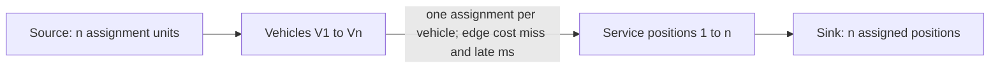

# FleetLab NF04 Corrections and Delivery Order — Final Design and Implementation Plan

> **For agentic workers:** After owner approval, use `superpowers:executing-plans` to implement this plan task by task. Steps use checkboxes. Owner approved implementation, repository push and educational-site publication in the subsequent October 13 message. This grants no permission to operate vehicles.

**Date:** October 13, 2026, America/Los_Angeles.

**Implementation status:** Published from `f8b3b27` after independent review and final validation. See [the implementation and release handoff](../../FLEETLAB_DELIVERY_ORDER_IMPLEMENTATION_HANDOFF.md) for actual counts, target exceptions and remaining device/human observations. Original proposal language below is retained as design context; it is not a claim that this work is still pending.

**Goal:** Make NF04's explanation dependable, then let a visitor choose a delivery order, compare individual consequences, and inspect an exact optimum within a small, explicitly bounded scheduling problem.

**Architecture:** Preserve NF04's numerical engine, verifier and published studies. Add a separate compact interval model for serial local delivery after one cold fetch, an independent checker, and exhaustive evaluation of at most 24 orders. A worker supplies accepted records to a read-only visual projection; packaging retains one deduplicated teaching build and one atomic website generation.

**Tech stack:** Existing dependency-free JavaScript modules, Node test runner, native DOM/CSS/SVG, Web Worker, existing Python integration and release tools. No solver dependency, backend, new media or browser persistence.

**Spec:** Sections 1–9 of this document are the consolidated design. Section 10 is its implementation plan. This single file supersedes the conflicting next-slice prescriptions in the two October 13 reviews; it does not replace the released NF04 contract.

## Global constraints

- Current owner instruction authorizes incorporating the five final amendments, implementation, tests, validation, repository push and live educational-site publication. Historical AGENTS §19 restrictions are overridden only for this scope.
- All quantities and outcomes are synthetic teaching examples. No Waymo-internal architecture, performance or policy is inferred.
- Keep `SIMULATION_ONLY`, `NOT_EVIDENCE`, `NOT_AUTHENTICATED`, `NOT_EVALUATED`, decision authority `NONE`, deployment permission `NONE` separate.
- Keep existing Overview, Fleet day, Street lab, learning content, City Explorer, NF01–NF04 and their routes. No Austin, additional city, power evaluation or SF map qualification work in this slice.
- Correct NF04 presentation without changing its input/record/policy/verifier schemas, 16 published study identities, allocation semantics or model results.
- New lesson: 1–4 vehicles, one empty-cache depot, one 12,000,000,000-byte artifact, fixed service rates, passing 60-second checks and 30-second activation, all requests known by the 96-second decision boundary. Exactly one nonpreemptive local receipt at a time, no idle gaps.
- Primary quantum 1,000 ms; build-time refinement 250 ms; horizon 2,400,000 ms. Raw deadlines are integer milliseconds and inclusive.
- No dependency, CSP relaxation, network capability, telemetry, storage capability or silent budget increase.
- Preserve offline HTML byte-for-byte. Protect legacy/NF03 payload except the explicitly owned and measured hosted onward navigation described below.
- Verification and completeness are separate. Never label a partially checked enumeration optimal or an impossible deadline a physically impossible schedule.

## Review focus

1. Navigating away during computation or after acceptance must terminate pending work without falsely cancelling an accepted result. Task 1 covers both paths and late worker messages.
2. Changing a preset while an edited order is pending must never attach old numbers to new labels or discard the saved user order. Task 6 covers dirty/pending/accepted identities.
3. An optimum pointer with a missing candidate, duplicate permutation or incomplete tie list must fail closed even when its digest is recomputed. Task 4 checks independent permutation coverage.
4. Unsupported caps, later arrivals, failed checks or incomplete work must not silently enter the compact model. Task 3 rejects them before scheduling.
5. Source-module, manifest or worker failures must leave readable navigation and scope text, with no fabricated successful outcome. Tasks 1, 5 and 6 cover those paths.

---

## 1. Recommendation and evidence basis

**Approve two sequential deliverables: (A) NF04 clarity and accessibility corrections; (B) “Who gets the depot link first?”, a named Delivery order companion lesson immediately after NF04.** Keep NF-05 reserved for availability and observation freshness. A separate route, `/network-flows/delivery-order/`, fits the existing Network Flows collection; no new top-level website tab is needed.

This is a real small optimization problem. The product value is making its objective, feasible set, individual trade-offs and proof of completeness understandable. It is not a general fleet optimizer or a reconstruction of Waymo operations.

### Inspected baseline

| Item | Evidence in this review |
|---|---|
| Repository | `Hermes-fleetlab repository root`, branch `codex/fleetlab-city-sf` |
| HEAD | `009af845c6d8bad2f1016627b7cdf56a58258609`; documentation after released app source `f54496ed47f76b9378277f979318fc0f36a482f1` |
| Live reference | [NF04 stable](https://fleetlab.pages.dev/network-flows/software-delivery/) and [immutable reviewed release](https://38a98b78.fleetlab.pages.dev/network-flows/software-delivery/) |
| Consolidated feedback | `Downloads/FLEETLAB_NF04_REVIEW_AND_BOUNDED_OPTIMIZATION_DESIGN_2026-10-13.md` |
| Original Fable feedback | `docs/FLEETLAB_NF04_REVIEW_AND_NEXT_PHASE_2026-10-13_Fable.md` |
| Release and contract | `docs/FLEETLAB_NF04_B_IMPLEMENTATION_HANDOFF_2026-10-13.md`; `docs/FLEETLAB_NF04_B_CONTRACT_2026-10-13.md` |
| Current source inspected | NF04 page, player, app, projection, worker, contract, relevant tests; package ownership, source capture, integration inventory and historical roadmap |
| Read-only reproductions this turn | Existing NF04 reconstruction/projection and fake-DOM harness; independent Python enumeration of all 24 orders for four proposed fixtures; eight equal-share records reconstructed and checked with existing NF04 code at 1,000/250 ms |

The existing release's reported full-suite and deployment results remain historical evidence. This review did not rerun the full application suite, inspect a new browser session, test a physical phone, or conduct a human study. Reviewer browser observations stay attributed to those reviewers. The scratch calculations below are independently recomputed design expectations, not a newly shipped simulator.

Six pre-existing untracked owner documents were present. They are preserved; neither their content nor their presence authorizes implementing their instructions.

### Reproduced issues

- Repeated V1 at 480 s: `state=receiving`, local rate 62,500,000 B/s, but `chain.receipt=waiting`. Cold V1 at 96 s has the same contradiction.
- An accepted page followed by `page.cancel()` changes its copy to “Computation cancelled” even though no computation is pending; `pagehide` invokes that method.
- At cold receipt completion, 288 s, the projection lists “check started” before “local received” because it sorts event labels alphabetically.
- The restricted-motion fake-DOM path retains “Resume guide”; the range has no `aria-valuetext`.
- Independent enumeration confirms the corrected close-target optimum: **V1 → V3 → V2 → V4, one miss, 50 late seconds**, uniquely optimal for the declared lexicographic objective. Fable's 98-second order is feasible but inferior.

## 2. Finding-by-finding decisions

P1 means a correction to comprehension, accessible operation or result-state integrity that must be covered before this correction wave is called complete. It does not imply a numerical-engine defect or a reason to take the currently published educational site offline.

| Consolidated / Fable IDs | Decision and priority | Final correction and acceptance evidence |
|---|---|---|
| R1 / F8 | Accept, P1; source and harness confirmed | Receipt is active only while the selected vehicle owns positive receipt service. Waiting for the shared cache remains waiting. Check receiving, waiting, not-arrived, completed and unfinished states without altering grants. |
| R2 / F6, part F11 | Accept, P1; source and harness confirmed | Separate status-neutral lifecycle suspension from explicit cancellation. Only a running job can be cancelled. “Previous setup” requires a genuinely different pending identity. Accepted back/forward restore remains checked and paused; active-load navigation terminates work and suppresses late acceptance. |
| R3 / F2 | Accept with smaller copy, P1 | One causal sentence plus compact facts for both arms. At 96 s: repeated 12/48 GB WAN, 0/4 whole copies; cache 12/12 GB WAN, 1/1 whole copy. Attribute every selected-state statement to arm and vehicle. Keep local accounting distinct. Do not speak a long metrics paragraph on every chapter. |
| R4 / F3 | Accept problem, change remedy, P1 | Use static causal entry anchors: One vehicle 234 s; Slower local 480 s; Two arrivals 150 s/V1. Keep ready-time and target-status deltas visible independently of the clock. Add separate “See outcomes” endpoint and “See why” anchor controls. Do not force every example to its endpoint or add counterexample autoplay. |
| R5 / F4, F5, F12 | Accept, P1 | Vehicle accessible name includes arm, ID and current state; preserve `aria-pressed`. Slider says seconds and full horizon. Announce one concise result per committed chapter/event/vehicle action, not every frame or slider input. Preserve visible caveats; speech is not a substitute for them. Test native assistive behavior separately. |
| R6 / F1, F9 | Accept, P1; source confirmed | Restricted mode says “Six held snapshots”; expose manual previous/next chapter and Replay-to-first actions, and remove automatic Play/Resume controls. Ended guide offers Replay, not Resume. Timeline Play at its endpoint becomes Replay from 0. Mode-specific labels must describe the action. Preference changes pause and never restart automatically. |
| R7 / F14 | Accept targeted correction, P1 | After a user-triggered load, move focus to a stable comparison heading only if the user has not moved elsewhere. Before hiding a focused Cancel/pending control, restore focus to its trigger. Chapter advances never steal focus. Verify actual keyboard behavior, not only fake DOM. |
| R8 / F7, F11, F13, part F17 | Accept, P2 | Promote “Local delivery: 48 GB in both arms” to 15–16 px. Core causal labels at least 14 px, prose around 16 px, detail text with restrained line lengths. Format exact integers with grouping and units; show refinement changes as readable sentences. Keep unequal values explicit. Measure contrast and reflow; avoid indiscriminate font enlargement. |
| R9 / event ordering | Accept, P2; source and harness confirmed | Preserve the accepted record's task ordering within each timestamp; keep source/arrival/target markers in a separate same-time group. Never alphabetize causal tasks. Do not change engine event ordering to repair presentation. |
| R10 / F16 | Accept, P2; source inspected | Add hosted NF03 → NF04 and, later, NF04 → Delivery order navigation only when the destination is in the same release. Prefer the integration-owned navigation mechanism; count transformed bytes and update Python/JS inventory expectations together. No broad navigation rewrite. |
| R11 / F15 | Accept as verified source risk, P2 | Empty root is vulnerable to module/boot failures. Put a title, scope, loading/help text and Home link in static HTML; replace only on successful mount. Show a specific error if app code can catch it. Test blocked module, invalid manifest and worker failure. A reviewer fetch-tool error is not evidence of a broken source download. |
| R12 / F10, part F11 | Accept scoped remedy, P2 | Primary chapter, arm, order and action targets at least 44 × 44 CSS px, including 320 px layouts. Wrap chapter controls to three columns when needed. Verify width and height, keyboard focus and overflow. Do not turn every inline prose link into a large button. |
| F17 check timing | Partial acceptance | Exact-byte formatting helps. Remaining check time already exists in projection `cause`; improve its prominence instead of inventing a missing model field. In Two arrivals at 150 s, repeated V1 is checking until 204 s; cold V1 is receiving, and at 200 s checks until 248 s. Reject the proposed 300 s example. |
| Refuted SM-08 | Reject defect claim | Cold selected-vehicle WAN bytes/rate of zero are correct; the shared depot fetch owns the WAN work. Explain the distinction, preserve its accounting. |

Fable's table contains F1–F17 plus a refuted item; its statement “eighteen findings” is not treated as an extra unspecified requirement.

**Protected numerical assets:** `software-delivery-contract.js`, `software-delivery.js`, `software-delivery-verify.js`, and `software-delivery-study.js`. Presentation tests will rerun all four NF04 cases; `software-delivery-study.mjs --check` must reproduce all 16 identities. The correction release establishes a new presentation baseline before adding the companion.

## 3. Consolidated next-phase choices

| Proposal | Final decision | Reason |
|---|---|---|
| Fixed local service order after a shared fetch | Adopt | Adds a visitor decision and an exact reference with very little new physics. |
| General preemptive priorities on WAN and local links | Defer | Requires substantially more engine, verifier and policy semantics. It is not needed to explain this decision. |
| All 24 permutations | Adopt as a real bounded optimizer | Every permitted order can be evaluated and independently checked. No external solver is justified at this size. |
| “Hindsight” label for best order | Reject for this domain | Every arrival and declared target is known when the depot copy completes at 96 s. All compared order rules have the same information. Say “Best of 24 permitted orders; all inputs known at 96 s.” |
| Universal “proven optimal schedule” | Reject | The optimum is exact over the supported serial order class. Other allocations, future arrivals, lower caps, failures and coupled resources are outside it. |
| Four simultaneous arm diagrams | Replace with two | First come versus Your order is the primary bench. Best, earliest target and equal share are explicit secondary comparisons. |
| Five broad public cases | Narrow | Three public cases: differing targets, an impossible target, close targets. Equal-target ties remain a checked fixture and concise explanatory disclosure. |
| Close-target case only in tests | Amend consolidated recommendation | Keep it public: it demonstrates why a correct optimizer adds value beyond sorting targets, while exposing the increased lateness suffered by one vehicle. |
| Public all-tie preset | Reduce to disclosure | It is important proof against a manufactured winner, but less useful as a third separate lesson than the close-target counterexample. All 24 tied orders remain inspectable. |
| Runtime full NF04 trace for every permutation | Reject | Four compact intervals per order suffice. Running 24 dense time-step NF04 variants adds cost without useful evidence. |
| Equal share baseline | Retain, secondary | Build and verify it using unchanged NF04 code on the newly declared input. Its digest is new where the input differs; it is not an old published default result relabeled. |
| Free-form inputs, failure/censoring ranking, Pareto dashboard, lower-bound taxonomy | Defer | They expand the contract substantially. This lesson rejects unsupported domains and reports all supported individual delays without a weighted score. |
| Blender/3D/packet animation | Defer | A schedule strip, assignment matrix and task tails explain the quantities precisely and have strong static/accessible equivalents. |
| Joint charging/data, then multi-depot | Preserve as future design candidates | Each needs a new question, contract and evidence base. They are not implicitly authorized by approval of this slice. |

## 4. Visitor experience and learning goals

**Question:** “Four vehicles need one depot copy. Who should receive it first?”

**Held fixed:** one 12 GB depot fetch, four 12 GB local receipts, link capacities, arrivals, checks and activation. **Changed:** the order of local receipts.

Within the first minute a visitor should see that a fleet improvement can make an individual vehicle later. In approximately three minutes they should distinguish a good heuristic, an exact answer within a declared class, an impossible target and the limits of the model.

| Audience | Concrete takeaway | Product evidence |
|---|---|---|
| Engineering | A receipt can finish while the previous vehicle checks/activates; a shared artifact is different from conserved assignment units. | Time strips, fixed task tails, assignment graph disclosure. |
| Product / Network Flows | The objective changes the recommendation. More on-time vehicles can mean more total or worst lateness. | Impossible-target and close-target outcome comparisons; exact objective printed next to Best. |
| Fleet operations | The relevant link deadline is the ready target minus downstream task time; urgent-first can waste scarce early service on a lost target. | Receive-by markers and V1's 220 s example. |
| Fleet management | An aggregate count hides who absorbs the delay. | Persistent per-vehicle before/after table, no winner badge. |
| Depot partnerships | Useful throughput, arrival/target distributions, receiver caps and actual task durations determine applicability. | “What would we measure?” checklist, not an equipment recommendation. |
| Business / sales | Explain the operational trade-off without claiming calibrated revenue, safety or operator endorsement. | Plain-language results and an explicit synthetic scope line. |

### Desktop layout

```text
Who gets the depot link first?
Only local delivery order changes. Synthetic model; no deployment authority.
[Compare my order]   Published summary / Checking / Checked

                   First come           Your order
Ready by target         2/4                   2/4
Total late time        178 s                 178 s
Worst late time        138 s                 138 s
WAN / local work       12 / 48 GB            12 / 48 GB
Your starting order matches First come. Move a vehicle to test a change.

[V1  earlier later] [V2  earlier later] [V3 ...] [V4 ...]
[Reset] [Try earliest target] [Show best of 24] [Restore my order]

First come strip       | receipt | check | activation | ready/target
Compared order strip   | same time scale; selected vehicle linked |
Who waits longer?      V1: 234 → 234 s (0 s), same starting order
Six held chapters / manual time / vehicle selection

> Why this order? [vehicle × service-position assignment matrix]
> Compare equal sharing [checked NF04 baseline, separate policy class]
> Test the limits [Impossible target] [Close targets]
> Equal targets: every order ties on the objective
> All orders, exact values, assumptions and trust states
```

“Show best” changes the right-hand arm's label to **Best permitted order**, not “Your order.” It retains the user's order for Restore. Moving a vehicle afterward explicitly returns to Your order. Before Compare, keep previous accepted results labeled and show that edits are pending; never imply an uncomputed improvement.

On mobile, outcome deltas remain visible above a two-button arm selector. Show one strip at a time on the same scale. Preserve selected arm, vehicle, time and saved user order through view changes. The order editor uses Earlier/Later buttons, works with keyboard and touch, and does not require dragging. At 320 px, chapter controls wrap; tables have a readable stacked equivalent.

### Quantitative visuals

- Schedule rows share a 0–480 s overview axis in public cases; a separate labeled control exposes the full 2,400 s observation window. Do not compress one policy's axis to make it look faster.
- Receipt, check and activation have different text/patterns as well as color. A mark names the raw target and another names receive-by. Readiness marker says on time or exact lateness.
- Color continues FleetLab's ivory/teal palette with restrained peach/lilac accents. A missed target uses text and an outline; it is not a real vehicle safety alert.
- The assignment matrix shows four vehicles against four service positions, their ready times, and each cell's miss/lateness pair. Highlight selected assignments and their matching strip, with a text table fallback.
- No route map is used for a depot-link scheduling decision. No cars appear to drive when the record describes stationary receipt.

### Guided comparison

One explicit Watch/Compare action checks the records; only the identity-matched default FCFS-versus-best guide may then advance automatically, respecting existing preferences. The user's arbitrary order receives computed static explanations, not default-authored conclusions.

| Held snapshot | What the visitor sees and learns |
|---|---|
| 0 s | Same cold WAN fetch and known scenario; no invisible preload. |
| 96 s | The complete copy becomes available; V1 receives first under FCFS, V4 under Best. |
| 144 s | First local receipt ends; its check starts while the next vehicle receives. |
| 234 s | Best's V4 is ready before its 240 s target. |
| 330 s | FCFS's V3 is 40 s late; Best's V2 is on time. |
| 378 s | All vehicles ready in both orders, same bytes; compare 2/4 versus 4/4, including V1's +144 s delay. |

Approximately 40 seconds of narration holds are presentation pacing, not simulated time. Restricted-motion/data mode shows the same six static snapshots and tables. User interaction pauses the guide; returning from background/history does not silently restart it.

## 5. Model, objective and corrected examples

### Strict supported domain

The new input wraps an existing normalized NF04 common input, with its own schema and domain version. This reuses validation/canonicalization, not its allocation algorithm.

```js
{ schema: 'fleetlab.delivery-order-input/1.0.0',
  domain: 'cold-serial-known-at-copy/1.0.0',
  delivery: /* normalized NF04 input: exact contract below */ }
```

The inner input has P=0, H=2,400,000 ms; q is 1,000 or 250 ms; empty inventory; artifact size 12,000,000,000 B, source available at 0; WAN aggregate/cap both 125,000,000 B/s; local aggregate/cap both 250,000,000 B/s. Checks are 60,000 ms/pass and activation 30,000 ms. There are 1–4 unique IDs, at least one arrival at 0, and every arrival's applied boundary is at most 96,000 ms. Raw target is an integer in [0,H]. All metadata remains canonical and part of identity. Public cases use arrivals [0,30,60,90] seconds.

Reject unsupported resource values, inventory, after-copy arrivals, check failures, task durations, policies, horizons and quantum values. Do not approximate them or silently run NF04's more general behavior. All supported schedules finish within H; failed/unfinished/censored rankings are outside this contract. Deadline failure remains an ordinary supported outcome.

### Arithmetic

Fetch time = 12 GB / 0.125 GB/s = **96 s**. Each full-rate local receipt takes **48 s**. Checks plus activation take **90 s**, independently per vehicle, and may overlap other receipts.

For service position k=1…n:

`receipt_end(k) = 96,000 + 48,000 × k`

`ready(k) = receipt_end(k) + 60,000 + 30,000`

Four ready positions are **234, 282, 330, 378 s**. Receive-by is the raw target minus 90 s; a completed receipt must fall on a service boundary no later than this raw time. The UI does not round a target into success.

For an order π, minimize lexicographically:

1. `M = count(ready_i > raw_target_i)` — missed vehicles.
2. `L = sum(max(0, ready_i - raw_target_i))` — total late milliseconds.

Always report maximum individual lateness, every ready time and the delay relative to the baseline. They are not secretly weighted into the objective. Keep all equal `(M,L)` optima; display the ASCII-smallest permutation only as a stable representative, with the tie count beside it.

### Independently enumerated design fixtures

In this table “2/4; 178 s” means two on time, 178 total late seconds. These are design expectations recomputed this turn with Python `itertools.permutations`; production must independently reproduce them.

| Fixture; targets V1/V2/V3/V4 (s) | FCFS | Earliest target | Exact best of 24 | NF04 equal share, checked this review |
|---|---|---|---|---|
| Public default: 480/340/290/240 | 2/4; 178 s | 4/4; 0 s | V4,V3,V2,V1; 4/4; 0 s; unique | 1/4; 264 s |
| Public impossible target: 220/340/290/240 | 1/4; 192 s | 0/4; 134 s; worst 42 s | V4,V3,V2,V1; 3/4; 158 s; worst 158 s; unique | 0/4; 422 s |
| Public close targets: 235/280/328/480 | 2/4; 4 s; worst 2 s | Same as FCFS | V1,V3,V2,V4; 3/4; **50 s**; worst 50 s; unique | 1/4; 291 s |
| Tie disclosure/test: 480/480/480/480 | 4/4; 0 s | 4/4; 0 s | All 24 tie; individual times still differ | 4/4; 0 s |

Miss-count histograms, for 0/1/2/3/4 misses: default `[1,11,11,1,0]`; impossible `[0,1,11,11,1]`; close `[0,4,16,4,0]`; tie `[24,0,0,0,0]`.

**Corrections that matter:**

- Fable's close-target order V1,V3,V4,V2 yields 98 late seconds; V1,V3,V2,V4 yields 50 with the same one miss. Do not freeze 98 as an optimum.
- The impossible-target optimum improves on-time count over earliest-target-first while **increasing** total lateness from 134 to 158 s and worst lateness from 42 to 158 s. Display this mixed outcome.
- Default V1 moves from 234 to 378 s, +144 s, while remaining on time. Close-target V2 moves from 282 to 330 s: lateness grows from 2 to 50 s, while V3 becomes on time.
- V1's impossible 220 s target requires receipt by 130 s. Only 34 s of local service are available after the copy arrives: **8.5 GB possible, 12 GB required**. Earliest readiness is 234 s. One miss is unavoidable, but the schedule itself is feasible. This is a directly checked explanation, not a general lower-bound framework.
- Equal-share results above were also reconstructed and checked this turn using unchanged `runDelivery` and `verifyDelivery`, at both 1,000 and 250 ms: all eight passed; each has all-ready time 378,000 ms. This verifies the existing baseline on proposed inputs, not the unbuilt serial model. The eventual page's full checked equal-share record is secondary and loaded only on explicit request.

Primary equal-share identity anchors from that read-only check (these are **NF04 common-input** identities, not the future new wrapper/study identities):

| Fixture | NF04 input SHA-256 at 1,000 ms | NF04 cold record SHA-256 |
|---|---|---|
| Default | `34431a88b7646ce8f00937eefe2ac1f3f34fc41c0fc0c2d6d3faaf48d332fc8f` | `c2100d6ae0f2e761fe87ed7116f92506c70924f884c2dabaffd42b0f2cf862c6` |
| Impossible | `80e54ab839c758eb622246acb54727607a584eff4f37e675f13d5f03f98c69ad` | `578206dd9293edcc62b59d6a0ac02b5270206170839c5986f9b4082f9e5ef045` |
| Close | `cc2e412e1262acb1c8c726c7df15b9fbf5e9c965a68929ea70ed841d32984c28` | `e07fa11fc52d815c1f6b01f23d57e8e5f22c901ec49a3c5317ed178df7a3451a` |
| Tie | `fc135e519c6b26c05f5bb3565ef98d520df62bf995a1841ae2ffcf176baeaf53` | `324b4cdd570f520fa4a61dac3f6d93fb31d4b6d25d68916b04796f9edf96ebcf` |

### The Network Flows connection is exact in this restricted domain

Every vehicle must occupy one service position; every position admits one vehicle. Create source → vehicle → position → sink arcs of capacity one. Vehicle-to-position edge (i,k) carries miss cost `m_ik` and lateness `l_ik` derived from `ready(k)` and target i. Sending n assignment units is exactly a permutation.



This is the standard assignment-to-min-cost-flow construction applied to these fixed service positions, **our derivation**, not a claim from an AV paper. If scalar costs are required for an independent future comparison, choose `W = 1 + sum_i max_k(l_ik)` and `c_ik = W*m_ik + l_ik`. Then one fewer miss dominates every possible lateness difference; no subjective weight is introduced. The browser implementation compares integer pairs directly.

Assignment units are vehicles-to-positions, not bytes. The fixed shared WAN copy remains separate: one upstream copy used for four local deliveries is not ordinary byte-flow conservation. Unequal receipt durations, future arrivals with idle periods, lower receiver caps or shared check/activation resources invalidate this simple fixed-position construction. Varying independent tails alone does not necessarily invalidate assignment; it changes per-vehicle edge costs, but is outside this first contract.

## 6. Record, verifier and runtime design

### Compact evidence, distinct from NF04 records

Do not disguise a serial schedule as an NF04 resource-grant trace or reuse its schema. Create `fleetlab.delivery-order-record/1.0.0`, with policy `serial-local/1.0.0`:

```js
{
  schema, policy_version, input, input_digest, order,
  fetch: {start_ms, end_ms, bytes},
  vehicles: [{id,
    receive_start_ms, receive_end_ms, received_bytes,
    check_start_ms, check_end_ms,
    activation_start_ms, ready_ms, deadline_ms}],
  metrics: {request_count, on_time_count, missed_count,
    late_ms_total, max_late_ms, all_ready_ms, wan_bytes, local_bytes},
  record_digest
}
```

Store vehicles in canonical ID order; `order` preserves service order. Hash every field except `record_digest`. The shared fetch is 12 GB, each vehicle receipt is 12 GB, local total is n×12 GB. Model state at an earlier clock derives from intervals without exposing future completion as already occurred. Whole-run outcomes are explicitly labeled separately.

`verifyOrderRecord(record)` checks plain-data bounds, exact fields, domain, digests, a valid permutation, interval capacity/non-overlap, arrival and whole-copy prerequisites, exact bytes, check/activation precedence and all metrics independently. It imports only contracts and canonical/digest utilities, never producer/search/projection/data modules. Reject extra or contradictory intervals rather than rendering them.

`verifyOrderStudy(study)` checks every record and complete coverage. Assign each permutation an independently computed factoradic rank 0…n!−1; require every rank exactly once, no extras. Recompute each objective, optimum set, tie list and stable representative. This catches a producer and enumerator sharing the same omission. Build-time independent Python arithmetic supplies a second-language fixture oracle.

The study manifest stores normalized inputs, expected input/study digests, compact expected outcome summaries, complete optimum/tie metadata, the checked equal-share identity and 250 ms refinement results. No dense record bundles ship. On explicit Compare, a worker rebuilds **all** at most 24 compact records, verifies them and the coverage, and matches the manifest before atomically accepting a study. Reordering within an accepted study selects already checked records; it does not change input identity or silently launch a new simulation.

### Separate result states

| Dimension | States and user meaning |
|---|---|
| Computation | Idle, checking, cancelled, timed out, rejected, accepted. Cancellation terminates the worker; no late commit. |
| Record consistency | Published build check; checked in this browser; rejected. An old accepted study remains explicitly identified on failure. |
| Search coverage | Complete n!/n!; incomplete. Incomplete coverage cannot produce a newly accepted “Best” comparison. A valid individual order may remain inspectable, without an optimality claim. |
| Optimality | Best within the declared serial order class, only after complete checked coverage. Never “best real depot policy.” |
| Information | All inputs known at depot-copy completion. No hindsight/online advantage is claimed. |
| Applicability | Supported; unsupported domain. Unsupported is not infeasible. |
| Target result | On time / late, exact counts and milliseconds. Missing target success is not invalid model evidence. |
| Authority | Existing trust labels unchanged; consistency and optimality grant no real-world authority. |

A forged best pointer, missing tie or bad interval rejects the new study even if its digest has been recomputed. No generic green “trusted” badge. Published claims remain labeled as published until checked in the current browser.

### Resource and performance bounds

- Input canonical size ≤64 KiB; compact record ≤16 KiB; accepted complete study ≤256 KiB; n≤4, rows≤24. Reject before allocating large arrays. No per-quantum resource rows.
- Proposed desktop target: complete reconstruction/check p95 ≤250 ms, 20 trials each cold/warm, named machine. Projection/application p95 ≤50 ms. These are targets, not measured results.
- Equal-share detail uses the existing NF04 bounded worker/record path, only one cold record at primary quantum, with existing parsing ceilings. Report its additional time and memory separately; discard the dense record after producing the accepted compact baseline details needed by the page.
- Cancel acknowledgment ≤100 ms; worker termination ≤250 ms. Job token checks prevent stale responses from publishing. Timeout terminates work and preserves the prior labeled accepted study.
- Physical Pixel timing, peak heap, native accessibility and OS preference tests remain open until the device is actually visible and tested. A connected-device statement from an earlier date is not a current device measurement.

## 7. Packaging and integration plan

### Measured baseline, not assumed spare capacity

These are the released October 13 handoff values, not a new package build. Remeasure after NF04 corrections and after final integration.

| Counter | Released bytes | Existing hard limit / treatment |
|---|---:|---|
| Legacy teaching text | 2,598,990 | 2,621,440; unchanged by new route |
| NF04 route-local / final closure | 116,378 / 131,653 | Working 327,680 / hard 524,288 |
| NF03 final closure | 468,398 | 524,288; named hosted onward-link delta only |
| Final emitted text | 2,776,111 | 3,145,728 |
| Teaching original source/tools | 2,896,622 | 3,145,728 |
| Teaching receipt | 28,584 | 32,768 |
| Source offer compressed / extracted | 881,219 / 3,203,019 | 4,194,304 each |
| Offline HTML | 2,549,837 | Preserve exact bytes; existing cap 2,571,440 |
| Integration original source | 196,141 | Explicit owner/inventory; source growth still accounted |
| Combined net original growth | 138,103 | Existing working target 307,200 from fixed baseline `cf690bd7…` |

**Budget interpretation resolved from code:** `package-proof.mjs` captures every `src/*.js`, every `tools/*.mjs`, selected original HTML/CSS, validation policy and license. It does **not** include the test tree in that counter or source offer. Tests stay in Git and validation; we will not silently redefine the metric or omit required tests to fit a packaging target. The combined net-growth target already uses a fixed historical baseline; retain it cumulatively. There is no need for a new owner decision about what the existing counter means.

Working allocation for this entire wave, including NF04 correction, new route and packaging changes: **≤131,072 B captured teaching + integration original-source growth; ≤98,304 B final emitted growth; receipt growth ≤2,500 B**. At the old baseline these imply growth 269,175 B, emitted 2,874,415 B and receipt 31,084 B. They are design targets, not forecasts or permission to increase hard caps. New route-local target 96 KiB and closure hard cap 512 KiB; its closure includes all shared dependencies and applicable headers.

### Ownership work before payload work

The current tools explicitly recognize NF04's modules and files. Adding a route without extending ownership will fail. Add one declared `delivery-order` owner and scoped release sidecar; preserve existing legacy/NF03/NF04 classification, fail on unknown modules, and count shared dependencies in every consuming route closure while storing physical files once.

Update the authoritative teaching packer/checker/source-capture and both Python/JS integration inventories in one tested change. Capture new original HTML/CSS, all new tools and modules in the source offer; verify extraction reproduces the payload. Include the new route's scope, identity and final transformed-byte accounting. Keep existing header/security policies; no remote font or solver download.

Receipt growth is the tightest administrative budget. First use a compact route descriptor with the existing complete emitted inventory and a digest-bound route sidecar; do not duplicate every fingerprint in a new receipt block. Measure the real manifest and sidecar before the full UI. If the working allocation cannot fit, reduce optional detail UI, not source provenance, verifier checks or individual-trade-off content. Any required schema/cap change is a new design decision to present with measured evidence, not an automatic bypass.

NF03 onward navigation is an explicit integration transform, tested in both implementations and included in final closure measurements. It is the exception to presentation byte preservation; do not promise NF03 is byte-identical and then inject markup invisibly. The new lesson's later link from NF04 is similarly integration-owned. Existing teaching source files remain unchanged by those link transforms.

## 8. Research grounding and subsequent roadmap

Primary sources checked during this design review:

| Source | What it supports here | Boundary |
|---|---|---|
| [Google OR-Tools: Assignment as minimum-cost flow](https://developers.google.com/optimization/flow/assignment_min_cost_flow) | Unit-capacity vehicle-to-position assignment construction; our fixed-slot reduction maps directly to it. | Does not establish a general AV scheduling model or require shipping OR-Tools. |
| [Google OR-Tools: Job shop](https://developers.google.com/optimization/scheduling/job_shop) | Future coupled-resource model should explicitly represent precedence and resource non-overlap. | Charging has continuous/shared-power aspects beyond this simple example. |
| [Google OR-Tools: CP-SAT statuses](https://developers.google.com/optimization/cp/cp_solver) | Feasible, optimal, infeasible, invalid and unknown are different assertions. | These are conceptual guidance; our bounded checker defines its own accurately named statuses. |
| [Zhang, Rossi and Pavone: Routing Autonomous Vehicles in Congested Transportation Networks](https://arxiv.org/abs/1603.00939) | Research context for later routing/rebalancing and road-capacity questions. | Abstract/metadata checked here; its transportation model is not implemented by this depot lesson. |
| [Rossi, Iglesias, Alizadeh and Pavone: AMoD and the power network](https://arxiv.org/abs/1709.04906) | Research context for later coordination of vehicle service and charging/power constraints. | Abstract/metadata checked here; no paper's savings, calibration or deployment claims transfer to FleetLab. |

The numerical fixtures and min-cost reduction are independently derived here. Do not inherit unverified generalized scheduling theorems or numerical solver-size/licensing claims from review documents. They are unnecessary to justify exhaustive search over 24 assignments.

### What follows this slice

1. **Joint readiness at one depot, separate proposal:** decide when to schedule charging and data while respecting their interaction and checks. Define whether charging and transfer can overlap; distinguish discrete bays from shared power; explicitly model useful energy/SOC and departure readiness. Compare FCFS, a simple readiness heuristic and a bounded exact reference. This is a proposal candidate, not a promise to reuse NF03 charging assumptions without qualification.
2. **Availability/freshness and uncertainty, preserving reserved roadmap IDs:** introduce one uncertainty at a time and separate true workload from observed/estimated workload. Evaluate a fixed policy on paired held-out scenarios, rather than letting an optimizer see future realized outcomes and calling it operational foresight.
3. **Multi-depot assignment/service planning:** start with an explicitly synthetic two-depot corridor; trade travel against queues, link/energy capacity and useful availability. Later real geography requires travel-time, demand, map and ODD qualification. This does not start Austin or clear SF gates.

For Waymo employees, the credible demonstration is a product method: identify an operational decision, select sufficient simulator fidelity, state the objective and knowledge available, compare a baseline, expose regressions, independently check results and name the missing real-world evidence.

## 9. Acceptance, risks and completion meaning

### Automated and browser acceptance

- All R1–R12 corrections have discriminating regression coverage; all NF04 study identities unchanged.
- Every supported permutation is checked, coverage/ties complete, best objective matches the independent fixtures, 1 s/250 ms outcomes agree for fixed aligned cases.
- Reject malformed/accessor/sparse/oversize input, duplicate/missing IDs, changed rates, late arrivals, early receipt, overlapping receipts, incorrect bytes, wrong prerequisite timing, wrong metrics/digest, wrong best pointer and incomplete ties.
- Projection never recalculates allocation or chooses an optimum; only accepted values drive dynamic copy, tables and plots.
- No hidden run on page entry; no stale acceptance after edits/cancel/navigation; runtime failure preserves prior accepted identity. Reduced motion/data, ended/replay and foreground/history behavior work.
- 1440/768/390/320 px layouts; no horizontal page overflow; meaningful target widths/heights; full keyboard traversal; non-color encodings; seconds-based range labels; static boot fallback; no console errors. Do not call browser resizing a physical phone test.
- Complete package/source proof, existing negative mutation gates, route/header checks, unchanged offline bytes and City payload, full immutable and stable readback after an authorized release.

### Human/device checks remain separately visible

Try the physical Pixel when present; otherwise record unavailable. Test native screen reader, actual 200% browser zoom, preference changes, touch, timings and peak memory. Automated DOM checks can support these tasks but do not close a human usability finding.

Five independent participants should attempt: (1) why two policies with the same total bytes and last-ready time have different on-time counts; (2) who becomes later and by how much; (3) why earliest target is not always the selected objective's best order; (4) what is new beyond NF03; (5) what a checked optimal toy schedule does not authorize. Aim for at least 4/5 on each learning task, and no authority misunderstanding left unresolved. Report participant results, not an AI simulation of participants. Lack of these results does not prevent local engineering, but prevents claiming demonstrated comprehension or physical qualification.

| Risk | Mitigation / release implication |
|---|---|
| “Optimal” sounds universal | Adjacent policy-class and objective labels; coverage proof; reject unsupported input. |
| Aggregate gains conceal harm | Persistent per-vehicle delta table; impossible and close-target public cases; no winner badge. |
| Lesson repeats NF03 | New assignment matrix, shared-copy dependency, independently checked exhaustive reference and distinct counterexamples; participant task 4. |
| Fixed assumptions favor serial ordering | State full-link receivers, equal sizes and known arrivals prominently; equal share remains separate; no operational recommendation. |
| Packaging budget fails late | Measure ownership, source capture, real compact manifest and receipt before UI expansion. No silent cap changes. |
| UI correction changes model results | Protect numerical module hashes and 16 study identities; re-pin only the corrected presentation baseline. |
| Separate producer/checker share a mistake | Contract-only imports, factoradic coverage independent of enumerator, mutation tests, Python oracle. |

“Engineering complete” means implemented and validated within these contracts. “Published” additionally means the approved website generation is deployed and read back. Neither clears SF `HOLD/BLOCKED_MAP_QUALIFICATION`, human/device checks, authenticity or vehicle deployment authority.

## 10. Implementation plan after approval

All paths below are relative to `Hermes-fleetlab repository root`. Use an isolated execution checkout selected at implementation time; preserve owner edits. Tasks 1–2 form a useful NF04 correction release independently of Tasks 3–7. The source and release tools remain the final authority for exact build commands.

### Task 1 — Correct NF04 state, explanation and accessible controls

**Modify:** `playground/fleetlab/src/ui/software-delivery-view.js`, `software-delivery-page.js`, `software-delivery-player.js`, `software-delivery-app.js`; `playground/fleetlab/software-delivery/index.html`, `visual.css`.

**Tests:** existing `playground/fleetlab/test/software-delivery-{view,page,player}.test.mjs`; add `software-delivery-app.test.mjs` for lifecycle/boot behavior. Extend fake DOM only where needed; browser checks cover genuine focus.

**Interfaces:** Keep `createDeliveryProjection(record)`, `createDeliveryPlayer(options)`, `createDeliveryPage(options)` stable. Add `page.suspend()` for lifecycle cleanup; `page.cancel()` remains explicit user cancellation. Add projection `whole_copies:{complete,total}`. Page, static snapshots and concise announcements consume the same accepted projection.

- [x] Add a failing projection regression, then run it against current code:

```js
const p = createDeliveryProjection(runDelivery(deliveryInput(), 'cold'));
assert.equal(p.at(0, 'V1').chain.receipt, 'waiting');
assert.equal(p.at(96000, 'V1').chain.receipt, 'active');
assert.equal(p.at(288000, 'V1').chain.receipt, 'complete');
```

- [x] Add failing lifecycle assertions using existing `installFakeDom`/`createDeliveryPage` harness: accepted status survives `suspend()`; a loading suspension terminates pending work; resolving that old promise cannot replace accepted results. Reselecting the accepted preset does not label it Previous.
- [x] Implement receipt state from accepted selected-vehicle grants, stable task ordering, whole-copy facts and causal captions. Implement status-neutral suspension and intent-aware focus. Provide raw and grouped exact byte values in details.

```js
// Projection rule; no allocation is calculated here.
receipt = received ? 'complete'
  : state === 'receiving' ? 'active'
  : arrived ? 'waiting' : 'not-arrived';
// Lifecycle rule: stop an active job, but do not relabel an accepted result.
// Keep load-token invalidation even when no worker remains.
```

- [x] Add page tests for arm/vehicle/state names, seconds-based `aria-valuetext`, counterexample causal anchors plus outcome deltas, short committed announcements, 288/348 s event ordering, ended Replay and restricted static controls. Implement R3–R8 behavior without modifying the numerical modules.
- [x] Add readable static boot HTML; replace it after successful mounting. Bad-manifest boot and worker-failure paths are tested; typography/reflow/touch fixes were measured.
- [x] Observe actual unavailable boot-module loads in a private Chromium fixture for both NF04 and Delivery order. Heading, scope and Home remain readable; no accepted-result claim appears. The intentionally missing module returns 404; the public stage is unchanged.
- [x] Focused correction tests, full teaching suite and all 16 original NF04 study identities pass. Actual browser focus and navigation checked.
- [ ] R7 native preference/accessibility qualification: OS reduced-motion/Save-Data, screen reader and actual 200% zoom remain open; passing automated preference tests do not close this item.

### Task 2 — Add scoped onward navigation and pin the corrected baseline

**Modify:** `apps/fleetlab-city/hosted/integration.mjs`, `apps/fleetlab-city/tools/integrate-site.py`, `apps/fleetlab-city/deploy/integration-assets.mjs`; their existing tests `hosted-integration.test.mjs`, `integration-assets.test.mjs`, `tests/test_integration.py`; teaching `tools/software-delivery-package.mjs` final transformed closure accounting only if required by the actual injected path.

**Interfaces:** Destination discovery is generation-bound: NF04's sidecar/route must exist in the exact integrated inventory before adding its NF03 onward link. Python integration and JS reconstruction must produce identical transformed bytes.

- [x] Extend existing integration fixtures with assertions for NF03 footer → NF04 when present, no dead link when absent, and exact changed-path accounting. Add a deliberate unlisted NF03 byte mutation and confirm the existing guard rejects it.
- [x] Implement the narrow integration transform, not a rewrite of NF03 source or a generic unbounded exception. Count its final closure bytes and archive all changed integration originals.
- [x] Run `node --test apps/fleetlab-city/test/{hosted-integration,integration-assets}.test.mjs`, `python -m unittest discover -s apps/fleetlab-city/tests -p test_integration.py` and `node --test playground/fleetlab/test/{software-delivery-package,package-proof}.test.mjs`.
- [x] Complete the correction-wave browser/package gates, then record the corrected source commit, measured counters, protected module hashes and study digests. Any later Delivery order changes compare against this correction baseline. Commit only the reviewed correction scope after gates; do not include owner documents.

### Task 3 — Freeze the bounded contract and build independent interval checking

**Create:** `playground/fleetlab/src/model/delivery-order-contract.js`, `delivery-order.js`, `delivery-order-verify.js`; `playground/fleetlab/test/delivery-order-{model,independence}.test.mjs`; `docs/FLEETLAB_DELIVERY_ORDER_CONTRACT.md`.

**Interfaces:**

```js
normalizeOrderInput(raw) -> detached OrderInput // throws named domain/schema error
runDeliveryOrder(input, order) -> OrderRecord
verifyOrderRecord(record) -> {
  ok, errors, metrics, input_digest, record_digest
} // invalid results: null metrics and digests
```

Tests construct the three public inputs explicitly from `deliveryInput()` plus arrivals [0,30,60,90] seconds and their stated deadlines; no model-to-data import. The released NF04 default has all arrivals at zero, so copying it without those arrival edits would create a different input identity. Existing canonical/digest utilities and NF04 input normalization may be reused. The new contract performs all domain restrictions before producer or checker work.

- [x] Write the hand-calculated default test before implementation:

```js
const delivery = deliveryInput();
delivery.requests.forEach((r,i) => {
  r.arrival_ms = [0,30,60,90][i]*1000;
  r.deadline_ms = [480,340,290,240][i]*1000;
});
const input = {schema:'fleetlab.delivery-order-input/1.0.0',
  domain:'cold-serial-known-at-copy/1.0.0', delivery};
const r = runDeliveryOrder(input, ['V4','V3','V2','V1']);
assert.deepEqual(r.vehicles.map(v => v.ready_ms), [378000,330000,282000,234000]);
assert.equal(r.metrics.on_time_count, 4);
assert.equal(r.metrics.late_ms_total, 0);
assert.equal(verifyOrderRecord(r).ok, true);
```

- [x] Run the new tests and confirm missing implementation fails. Add domain rejection cases: fifth request, duplicate order ID, changed cap, arrival 96,001 ms, failure outcome, nonempty inventory, unsafe/accessor/sparse input. Add inclusive 282,000 versus 281,500 ms deadline tests.
- [x] Implement producer as serial interval accumulation: fetch completion 96,000; for each order member add 48,000 receipt, independently append 60,000 check and 30,000 activation; calculate integer metrics from outcomes. Keep record vehicles ID-sorted.
- [x] Implement checker independently using the fixed position equations and direct interval/capacity/precedence checks. Reject unknown fields and overlarge canonical records before traversal. Hash only after structural checks. Add mutations with recomputed digests to prove validation is not just hash comparison.
- [x] Add an import-closure test forbidding checker imports of producer, search, data or UI. Run `node --test playground/fleetlab/test/delivery-order-{model,independence}.test.mjs`. Expect positive and negative fixtures to pass without altering NF04 hashes.

### Task 4 — Search all orders, independently prove coverage, publish compact fixtures

**Create:** `playground/fleetlab/src/model/delivery-order-search.js`, `delivery-order-study-verify.js`; `playground/fleetlab/src/data/delivery-order-study.js`; `playground/fleetlab/tools/delivery-order-study.mjs`; `playground/fleetlab/test/delivery-order-{search,study}.test.mjs`; `tests/fixtures/delivery_order_oracle.py`.

**Interfaces:**

```js
searchDeliveryOrders(input) -> {
  schema:'fleetlab.delivery-order-study-record/1.0.0', input, input_digest,
  records, best_orders, representative_order, study_digest
}
verifyOrderStudy(study) -> {
  ok, errors, coverage:{expected,verified,complete},
  best_orders, representative_order, input_digest, study_digest
}
// ORDER_STUDY: inert published inputs, summaries, identities and refinement.
```

`verifyOrderStudy` may import the contract, `verifyOrderRecord` and canonical utilities; no search, producer or generated data import. Producer enumerates recursively; checker ranks each permutation independently.

- [x] Add close-target assertions before writing search:

```js
const study = searchDeliveryOrders(closeTargetsInput);
assert.deepEqual(study.best_orders, [['V1','V3','V2','V4']]);
const best = study.records.find(r => r.order.join() === 'V1,V3,V2,V4');
assert.equal(best.metrics.missed_count, 1);
assert.equal(best.metrics.late_ms_total, 50000);
assert.deepEqual(verifyOrderStudy(study).coverage,
  {expected:24,verified:24,complete:true});
```

- [x] Implement recursive enumeration and lexicographic `(missed_count,late_ms_total)` comparison. Preserve all ties and stable representative. Independently verify each record and factoradic rank coverage before accepting best metadata.
- [x] Add duplicate/missing-row, false-best, incomplete-tie and wrong-study-digest mutations; expected rejection even if an individual record is valid. Check 1–4 vehicles produce 1/2/6/24 orders. Run the Python oracle for all four design fixtures, compare histograms and all objective pairs, not just one winner.
- [x] Generate primary and refinement expectations; regenerate/check the equal-share baseline with unchanged `runDelivery` and `verifyDelivery` on each new common input. Keep the existing NF04 study file untouched. `delivery-order-study.mjs --check` compares canonical content and fails on mismatch without rewriting it.
- [x] Run `node --test playground/fleetlab/test/delivery-order-{study,independence}.test.mjs`, `python3 tests/fixtures/delivery_order_oracle.py` and `node playground/fleetlab/tools/delivery-order-study.mjs --check`.

### Task 5 — Establish the route owner, compact worker and packaging preflight

**Create:** `playground/fleetlab/tools/delivery-order-package.mjs`; `playground/fleetlab/src/runtime/delivery-order-{job,worker}.js`; `playground/fleetlab/delivery-order/{index.html,visual.css}`; minimal `playground/fleetlab/src/ui/delivery-order-{app,page}.js`; `playground/fleetlab/test/delivery-order-{job,package}.test.mjs`.

**Modify:** teaching `tools/pack.mjs`, `check-dist.mjs`, `package-proof.mjs`, `release-sidecar.mjs`, `software-delivery-package.mjs`; existing packaging tests; both City integration inventory implementations/tests from Task 2. Add the UI entry, worker and inert data as explicit new-owner entries; shared contract/core modules remain their original physical owner.

**Interfaces:** Worker receives `{token, entry}`; returns progress, rejected/error, or `{token,type:'done',result}` only after complete verification and manifest identity match. Job adapter terminates on cancel/timeout and accepts only current token. New sidecar schema `fleetlab.delivery-order-release/1.0.0` binds source, emitted closure and scope without authenticity claims.

- [x] Add worker tests: cancel while pending, stale response after new case, corrupted manifest, oversized returned study and interrupted coverage. Assert no rejected or cancelled result replaces the accepted reference.
- [x] Implement full compact study reconstruction/check in worker; keep drawing/projection out. Add separate optional equal-share operation using NF04 producer/checker; match the new input identity and do not allocate 24 dense traces.
- [x] Add a skeletal static page and real manifest to the declared route. Measure source/receipt/closure growth now, before full UI. Do not use a zero-content stub to claim the final design fits; reserve the remaining UI allowance explicitly against Section 7.
- [x] Add unknown-owner, missing-source-file, mutated NF03/NF04, undeclared import, understated closure and altered offline negative tests. Capture the original new page/CSS in both source capture and Git input inventory validation. Verify source-offer reproduction includes new tools and route inputs.
- [x] Run `node --test playground/fleetlab/test/{delivery-order-job,delivery-order-package,software-delivery-package,package-proof}.test.mjs` plus Task 2 integration tests. Record actual counters and remaining allocation. Do not proceed with an over-budget design by weakening a gate.

### Task 6 — Build the decision bench, assignment visual and honest static path

**Create:** `playground/fleetlab/src/ui/delivery-order-{view,player}.js`; `playground/fleetlab/test/delivery-order-{view,page,player}.test.mjs`.

**Modify:** minimal app/page/CSS/HTML from Task 5; integration discovery for catalog and NF04 onward link; existing hosted integration tests.

**Interfaces:**

```js
createOrderProjection(acceptedStudy) -> {
  outcome(order), at(order,time_ms,vehicleId), assignment(order)
}
createOrderPlayer({chapters,H_ms,onChange}) -> {
  state(), chapter(index), inspect(time_ms,vehicleId),
  pause(), replay(), preference(restricted), historyRestore(), advance(dt)
}
createOrderPage({manifest,runStudy,cancelStudy,reducedMotion}) -> {
  element, load(), cancel(), suspend(), selectCase(id), move(id,direction),
  showBest(), restoreOrder(), getState(), destroy()
}
```

`getState()` exposes pending input/order, accepted input identity, saved user order, viewed comparison order, selected vehicle/arm and clock for tests. Projection `outcome` reads checked metrics; `at` interprets intervals; `assignment` exposes recorded vehicle-position relationships and checked outcomes. Neither optimizes nor allocates.

- [x] Test the starting comparison equality, move/restore behavior, and acceptance identity before visual construction. A case edit while a previous study is pending must not relabel accepted numbers. The `showBest()` view must retain saved user order and visibly rename its right-hand arm.
- [x] Implement the two-arm comparison, keyboard order editor, fixed-scale strips and Who waits longer table. Bind best/case/guide copy to exact accepted identities. Add the assignment matrix as progressive detail with the explicit “assignment units, not bytes” explanation.
- [x] Build three public cases plus tie disclosure; verify impossible-target and close-target mixed outcomes. Add secondary earliest-target and equal-share comparisons without four simultaneous animated scenes. Store no user order in URL or browser storage.
- [x] Implement manual and approximately 40-second guided modes. Restricted preference yields held snapshots, not ineffective Play buttons. Preserve user intent, focus and selected arm through pause, inspection, history and layout changes.
- [x] Add tests for the changed-pending-order case, end/replay, every target boundary, exact values versus display rounding, static-table parity, accessible names and controlled announcements. Run `node --test playground/fleetlab/test/delivery-order-{view,page,player}.test.mjs`.
- [x] Validate rendered 1440/768/390/320 px layouts, keyboard focus, failure/restricted paths under tests, and measured desktop runtime targets. No operational authority is implied.
- [ ] Complete physical Pixel, native 200% zoom, assistive-technology/preference, paint/cancellation/peak-heap and human-comprehension observations. Device connected late in the run, but screen-mirror input prevented successful lesson navigation; do not count it as validated. See handoff for exact limits.

### Task 7 — Regression, source-bound release candidate and handoff

**Update after implementation:** `docs/FLEETLAB_DELIVERY_ORDER_IMPLEMENTATION_HANDOFF.md`, this plan's checkboxes, corrected NF04 handoff, and `docs/releases/fleetlab-current.json` only after an actual authorized publication. Follow `docs/FLEETLAB_CLOUDFLARE_DEPLOYMENT.md` for whole-generation staging, publication and rollback.

- [x] Run the existing full gates from the implementation checkout:

```sh
node --test playground/fleetlab/test/*.test.mjs
node --test apps/fleetlab-city/test/*.test.mjs
python -m unittest discover -s apps/fleetlab-city/tests
PYTHONPATH=src FLEET_PLAYGROUND_BASE=bca4ccd python -m pytest -q
python -m ruff check .
PYTHONPATH=src conda run -n hermes-dev python -m hermes doctor
node playground/fleetlab/tools/software-delivery-study.mjs --check
node playground/fleetlab/tools/delivery-order-study.mjs --check
git diff --check
```

- [x] Record actual passing counts, existing skips and any failures. Review changed files/staged diff and exclude owner documents/generated evidence. Make scoped local commits only after applicable gates. Build release artifacts from the exact reviewed commit, not a dirty source tree.
- [x] Use the existing runbook's pack, check-dist, package-proof and integration commands with the actual candidate SHA and fresh private output paths. Check original source archive, new route closure, final receipt, protected offline hash, City inventory, security headers, discovery links and all budget counters. Run the existing publication guard before any authorized upload.
- [x] Prepare one immutable integrated candidate. If publication is authorized for this implementation, push and publish through the existing whole-generation process, read back the full immutable inventory and stable alias, and test both NF04 and Delivery order. If only build was authorized, deliver the reviewable candidate and exact remaining release action.
- [x] Handoff includes source/deployment identities, tests, measured budgets/performance, screenshots, audit decision dispositions, fixture/digest results, known browser limitations, rollback target, and separate human/device/SF gates. Never carry forward an old “all done” statement as evidence of a new release.

## 11. Recommendation, top risks and next three actions

**Recommendation:** Approve this bounded two-deliverable plan. Start with NF04 corrections, then the Delivery order companion. Keep joint charging and multi-depot optimization as separate subsequent designs. Preserve the homepage's concrete depot-operations entry and the rest of FleetLab.

**Top risks + mitigations:** Overclaiming optimality is controlled by domain/coverage labels; hidden individual harm by the per-vehicle table and counterexamples; late packaging surprises by early source/receipt measurement. Human comprehension and physical qualification remain separate recorded work.

**Next three actions:**

1. Owner reviews this single design and implementation plan, including the three public cases and fixed objective.
2. After approval, implement and validate the NF04 correction wave, recording its corrected baseline and actual package deltas.
3. Build the bounded companion against that baseline, validate complete search and individual consequences, and prepare the integrated release with an updated evidence-backed handoff.

**Original design-review completion (before approval):** feedback consolidated and implementation plan written, with no code or publication at that stage. **Subsequent implementation:** all five final amendments adopted; NF04 checkpoint pinned; bounded companion built; all six independent-review findings fixed; source-bound application pushed and published. The handoff records actual final validation and the remaining qualification work.

## Approved final amendments — October 13, 2026

1. Every candidate must match the study normalized input, digest, domain, policy version and quantum. A valid foreign-workload record, rehashed into an otherwise complete study, is rejected. Study records are ordered lexicographically by permutation; best orders likewise; digest excludes only its own digest field.
2. Moving a vehicle edits only pending order. Compare selects a checked record when accepted input and versions match, otherwise reconstructs/checks the study. Displayed outcomes change only on explicit acceptance.
3. Initial deltas are zero. Show best never autoplays and preserves user order. Add explicit Watch worked example, start/resume transitions, default FCFS-versus-best identity binding; phone arm switching is view-only.
4. Execute small ownership/import/source-capture scaffold as Task 2b before Task 3. Real manifest and receipt measurements remain in Task 5 before full UI.
5. Name 128 KiB envelope captured teaching + integration original-source growth. Preserve existing counters; report test-tree and total repository growth separately. Add domain rejection tests for nonzero source availability and absence of an arrival at zero.

Final owner instruction supplies publication authority; no repeated permission question is needed.

Implementation ruling: the independent Python oracle lives under tests/fixtures, preserving the repository rule that playground contains no Python.

## Executed-plan reconciliation

- Task 2b ownership scaffold was committed with onward navigation before Task 3 payload. Task 5 used the real 17,593-byte manifest before full UI.
- Model/contract/record tests are consolidated in `delivery-order-model.test.mjs`; search/coverage tests in `delivery-order-study.test.mjs`; NF04 boot/lifecycle corrections in `software-delivery-corrections.test.mjs`. The separate independence tests remain.
- Correction checkpoint: `9ac9e81`; navigation/scaffold: `f2d72d0`; companion: `182a92a`; reviewed fixes: `f8b3b27`.
- Final teaching: 2,336 passed / 8 existing skips / 1 existing TODO; City Node 72, City Python 340, Hermes 1,662 passed / 55 existing skips. Full preview and stable byte readbacks both 10,069/10,069.
- All hard package caps remain intact. Two working growth targets were missed: emitted text +463 B above target; receipt +914 B above target. Captured teaching + integration original-source growth is 104,052 B / 131,072 B. Detailed counters and rationale are in the handoff.
- Physical device/native accessibility and human review remain open observations; neither successful website publication nor checked synthetic results resolve SF map qualification.
